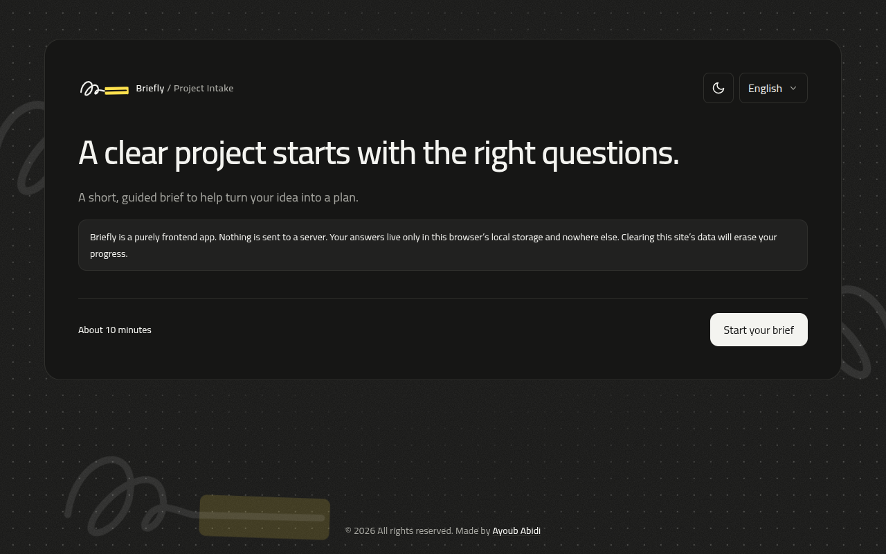

# Briefly



A guided client questionnaire that turns a project idea into a clear brief.

Send prospective clients a link. They answer a short set of questions, download a PDF brief, and send it to you by email or WhatsApp. Nothing touches a server.

**Live:** [briefly.ayoub3bidi.me](https://briefly.ayoub3bidi.me)

## Features

- **Templates** for different project types, picked with a URL parameter: `?t=web`, `?t=mobile`, `?t=auto` (automation) or `?t=generic` (the default).
- **English, French and Arabic**, with full right-to-left layout for Arabic. Pick one with `?lang=en|fr|ar`. Without it, Briefly uses the browser language.
- **PDF export** with a localized, RTL-aware brief (rendered in the browser with `@react-pdf/renderer`).
- **Send by email or WhatsApp** through `mailto:` and `wa.me` links to your contact details.
- **Resumable**: progress is saved locally, so a reload continues where the client left off.
- **Light and dark themes**, keyboard-friendly, with reduced-motion support.

## Privacy

Briefly is frontend-only. There is no backend, no analytics and no API calls. Answers live only in the client's `localStorage` until they choose to send the PDF.

## Tech stack

React 19, TypeScript, Vite, Tailwind CSS 4, Zustand, `@react-pdf/renderer`, Vitest + Testing Library, oxlint and Prettier. Deployed as static assets on Cloudflare Workers.

## Getting started

Requires Node 24 and pnpm 10 (`corepack enable` picks up the pinned version).

```sh
pnpm install
cp .env.example .env   # optional: set your contact details
pnpm dev
```

| Script              | What it does                              |
| ------------------- | ----------------------------------------- |
| `pnpm dev`          | Start the Vite dev server                 |
| `pnpm test`         | Run the unit tests                        |
| `pnpm lint`         | Lint with oxlint                          |
| `pnpm format:check` | Check formatting (`pnpm format` fixes it) |
| `pnpm build`        | Type-check and build to `dist/`           |
| `pnpm preview`      | Serve the production build                |

CI runs `format:check`, `lint`, `test` and `build` on every pull request.

## Deploy your own

Briefly is a static site, so it runs on any static host. To run your own instance:

1. **Fork** this repository.
2. **Set your contact details** in `.env` (locally) or as build-time environment variables:
   - `VITE_CONTACT_EMAIL`: the address clients send the brief to.
   - `VITE_CONTACT_WA`: your WhatsApp number in international format, e.g. `+15551234567`.

   These values are baked into the public bundle, so never put secrets in `VITE_*` variables.

3. **Change the footer credit** in `src/App.tsx` (the "Made by" link).
4. **Customize the questions** (optional) in `src/data/`. Read the rules in [AGENTS.md](AGENTS.md) first: question ids are persistence keys, and every label needs English, French and Arabic text.
5. **Deploy**:
   - **Cloudflare Workers**: in `wrangler.jsonc`, replace the `routes` entry with your own domain, or remove `routes` and set `"workers_dev": true`. Then run `pnpm run deploy`.
   - **Any other static host** (Netlify, Vercel, GitHub Pages, ...): run `pnpm build` and serve `dist/` with a fallback to `index.html`.

The included GitHub Actions workflow deploys to Cloudflare on every push to `main`. It needs these repository secrets:

- `CLOUDFLARE_API_TOKEN`: a token with Workers edit access for your account and zone.
- `CLOUDFLARE_ACCOUNT_ID`: your Cloudflare account ID.
- `VITE_CONTACT_EMAIL` and `VITE_CONTACT_WA`: the contact details described above.

`index.html` sets `noindex`. Remove it if you want search engines to index your instance.

## Releases

Releases are tag-driven. Pushing a SemVer tag runs the checks, creates a GitHub Release with notes generated from the Conventional Commits since the last tag, and deploys:

```sh
git tag v0.3.0
git push origin v0.3.0
```

You can also run the "Release" workflow manually from the Actions tab and supply the tag to cut.

## Contributing

Contributions are welcome. Read [CONTRIBUTING.md](CONTRIBUTING.md) before opening a pull request, and follow the [Code of Conduct](CODE_OF_CONDUCT.md). To report a vulnerability, see [SECURITY.md](SECURITY.md).

## License

[MIT](LICENSE) © Ayoub Abidi
